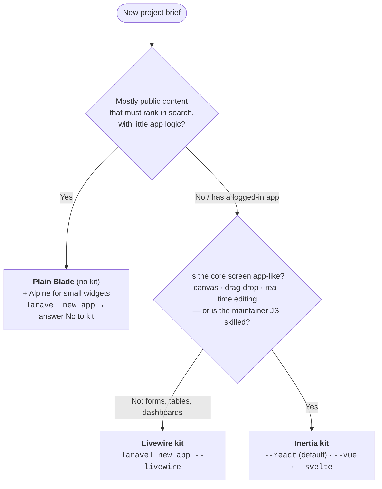

<div align="center">

# Laravel Frontends & Starter Kits — Decision Guide

**Pick the right Laravel 13 frontend stack and starter kit for each new project brief, then brief your AI assistant so it writes current code.**


[](https://github.com/XLR8Labs-io/laravel-decision/releases/latest)
[](https://github.com/XLR8Labs-io/laravel-decision/blob/main/LICENSE)

[](https://github.com/XLR8Labs-io/laravel-decision/issues/new?template=outdated-info.yml)

</div>

---

## How to use this guide

1. **Read the brief** and run it through the [Quick pick](#quick-pick) flow.
2. **Find the closest row** in the [decision matrix](#decision-matrix-by-project-requirement) and copy its install flag.
3. **Paste the [AI stack prompt](#paste-this-at-the-start-of-each-project-prompt)** at the start of your AI coding session.
4. **Check [Recent changes](#recent-changes-20252026)** before you rely on a version, price or installer detail.

> [!TIP]
> You can give this README to your AI assistant as context: it then knows which stack you chose and why, and which outdated patterns to avoid.

### Use it in your own project

Every [release](https://github.com/XLR8Labs-io/laravel-decision/releases) ships the guide as **`LARAVEL-STACK-GUIDE.md`**. It's the same content as this README, under a name that won't overwrite yours. Download it from the **[latest release](https://github.com/XLR8Labs-io/laravel-decision/releases/latest)**, or run this from your project root:

```bash
curl -fLo LARAVEL-STACK-GUIDE.md https://github.com/XLR8Labs-io/laravel-decision/releases/latest/download/LARAVEL-STACK-GUIDE.md
```

Then point your AI agent at it. Add a line like this to `CLAUDE.md`, `AGENTS.md`, `.cursorrules` or your agent's rules file:

```text
Before choosing a Laravel stack or writing Laravel code, read LARAVEL-STACK-GUIDE.md and follow its versions and "Building with AI" rules.
```

To hear about new versions, click **Watch → Custom → Releases** at the top of this repo. Run the same `curl` command again to update.

> [!IMPORTANT]
> **Laravel moves fast.** If you spot a release, price or installer change that isn't here yet, please **[open an "Outdated info" issue](https://github.com/XLR8Labs-io/laravel-decision/issues/new?template=outdated-info.yml)**. One line and a source link is enough, and the maintainer gets notified.

## Contents

- [Quick pick](#quick-pick)
- [Questions to answer from each brief](#questions-to-answer-from-each-brief)
- [Decision matrix by project requirement](#decision-matrix-by-project-requirement)
- [Comparison at a glance](#comparison-at-a-glance)
- [The frontend approaches](#the-frontend-approaches)
- [Official starter kits (Laravel 13)](#official-starter-kits-laravel-13)
- [Add-ons: admin panels, APIs, mobile, hosting](#add-ons-admin-panels-apis-mobile-hosting)
- [Installation cheat sheet](#installation-cheat-sheet)
- [Building with AI: tips per stack](#building-with-ai-tips-per-stack)
- [Recent changes (2025–2026)](#recent-changes-20252026)
- [Sources](#sources)
- [Contributing](#contributing)
- [License](#license)

---

## Quick pick

Answer two questions from the brief to choose the stack, then add whatever else it needs.



Then add what the brief asks for:

| If the brief needs… | Add | How |
| --- | --- | --- |
| A mobile app or other client consuming the data | **Sanctum API** | `php artisan install:api` |
| An admin back office | **Filament** | `composer require filament/filament` |
| Multi-tenant or team accounts | **Teams** | `--teams` at install (not with WorkOS) |

> [!NOTE]
> For briefs that are mostly forms, tables and dashboards, the **Livewire kit is the default**. Switch to an Inertia kit only for genuinely app-like screens or a JS-skilled maintainer.

## Questions to answer from each brief

| # | Question | Leads to |
| :-: | --- | --- |
| 1 | Does it need public SEO pages? | Lean Blade/Livewire, or plan Inertia SSR |
| 2 | Will a mobile app or another client consume the data? | Add a Sanctum API from day one |
| 3 | How interactive is the core screen? | Forms and tables → Livewire. Canvas, drag-drop, real-time collaboration → React |
| 4 | Who maintains it after handover? | PHP-only team → Livewire. JS team → React/Vue |
| 5 | Multi-tenant or team accounts? | Enable `--teams` at install (not available with WorkOS) |
| 6 | Admin back-office needed? | Filament on top of any kit |
| 7 | Users on slow connections? | Keep Livewire pages lean (islands, lazy loading, no per-keystroke calls) or favour client-rendered UI |

## Decision matrix by project requirement

Find the row closest to the brief. When two rows apply, **the stricter requirement wins** (SEO, mobile, heavy client UI).

| Project requirement | Pick | Install flag | Add-ons | Why |
| --- | --- | --- | --- | --- |
| Admin dashboard, CRM, internal tool, CRUD-heavy | **Livewire kit** | `--livewire` | Filament for data screens | Fastest delivery in one language; Filament shares Livewire |
| Client SaaS with logins, billing, team accounts | **Livewire or React kit** | `--livewire --teams` or `--react --teams` | Cashier, Filament admin | Teams, 2FA, passkeys already built; choose React only if UI is very interactive |
| Marketing site, landing page, blog, SEO-critical | **Plain Blade** (no kit) | answer "No" to kit | Alpine for small widgets | Full HTML on first load, no SSR server |
| SEO pages + logged-in app area | **Livewire kit** | `--livewire` | Alpine | Server-rendered everywhere, one stack |
| Highly interactive UI (builders, drag-drop boards, real-time editors, charts-heavy) | **React kit** | `--react` | Inertia live props + Reverb for real-time | Rich client state and largest component ecosystem |
| Client already uses Vue / wants Vue | **Vue kit** | `--vue` | — | Matches the client's team |
| Lightweight, fast-loading JS app, small scope | **Svelte kit** | `--svelte` | — | Leanest bundles; accept smaller ecosystem |
| Mobile app backend (Flutter / React Native) | **API-only + Sanctum** | no kit, or any kit + API routes | API Resources, versioned `/api/v1` | One backend for web + mobile; per-device revocable tokens |
| Web app + companion mobile app | **Livewire or React kit _plus_ Sanctum API** | kit flag + `install:api` | Shared service/action classes | Inertia pages are not an API; mobile needs its own endpoints |
| Separate Next.js / Nuxt frontend | **API-only + Sanctum** (cookie mode) | no kit | CORS + Sanctum SPA auth | Laravel stays the backend only |
| Needs Google/Apple login, SSO, passwordless | **Any kit, WorkOS variant** | choose "WorkOS" | — | Social login + SSO without building it; no teams |
| Strict, typed, long-lived codebase | **Nuno Maduro strict community kit** | `--using=` (see [community kits](#community-kits)) | Pest, PHPStan | Max static analysis from day one |
| Mobile app built only by PHP devs (experimental) | **Livewire + NativePHP Mobile v3** | — | — | Ships native binaries from Laravel; validate on real devices |
| Existing app on Breeze/Jetstream | **Keep it** | — | Upgrade Laravel 12 → 13 | No rebuild needed; kits are for new projects |

## Comparison at a glance

The real trade-off is **server round-trips and one language** (Blade/Livewire) versus **rich client UI and two toolchains** (Inertia kits).

| Stack / kit | Rendering | SEO out of the box | Interactivity | Skills needed | Reuse for mobile app | Best for |
| --- | --- | --- | --- | --- | --- | --- |
| Blade (no kit) | Server HTML, full reloads | 🟢 Excellent | Low | PHP | None (add API) | Landing pages, blogs, simple CRUD |
| Blade + Alpine | Server HTML + small JS | 🟢 Excellent | Low–medium | PHP + basic JS | None | Content sites with menus, tabs, modals |
| Livewire 4 kit + Flux | Server components over AJAX | 🟢 Excellent | Medium–high | PHP (+ a little Alpine) | None (add API) | Dashboards, portals, internal tools, SaaS admin |
| React kit (Inertia 3) | Client SPA, server routing; SSR optional | 🟡 Needs SSR | Very high | React 19, TypeScript, Laravel | Patterns transfer to React Native | App-like UIs, complex state, large ecosystems |
| Vue kit (Inertia 3) | Same as React | 🟡 Needs SSR | Very high | Vue 3, TypeScript, Laravel | Limited | Same as React, Vue-preferring builds |
| Svelte kit (Inertia 3) | Same as React | 🟡 Needs SSR | Very high | Svelte 5, TypeScript, Laravel | Limited | Lean JS, small bundles, smaller ecosystem |
| API-only + Sanctum | Laravel returns JSON | Depends on client | Depends on client | API design + client stack | Full | Mobile apps, Next/Nuxt frontends, integrations |
| WorkOS variant (any kit) | Same as base kit | Same | Same | Same + WorkOS account | n/a | Social login, SSO, passwordless |
| Breeze / Jetstream | Varies | Varies | Varies | Laravel | n/a | Existing apps only |

---

## The frontend approaches

Laravel gives you two ways to build a web UI:

- **PHP-first:** Blade, made interactive with Livewire and Alpine.
- **JavaScript:** Inertia, which plugs React, Vue or Svelte into normal Laravel routes.

For mobile apps or separate frontends, Laravel serves a JSON API secured with Sanctum.

### A. Blade (server-rendered PHP templates)

- **How it works:** a route and controller render a `.blade.php` template into full HTML on the server. Blade adds `@if`, `@foreach`, components and layouts on top of PHP.
- **Strengths:** simplest model, one language, excellent SEO, almost no JS build work.
- **Weaknesses:** every interaction is a full page reload unless you add Alpine or Livewire.
- **Pick it for:** landing pages, blogs, catalogues, simple CRUD, anything SEO-first with light interactivity.

> [!NOTE]
> There is no official Blade-only starter kit. Answering "No" to the starter-kit prompt gives plain Blade with no auth. Laravel points to the Livewire kit as the closest option.

### B. Livewire 4 (+ Flux UI; Volt is now merged in)

- **How it works:** you write components in PHP + Blade. Actions like `wire:click` and `wire:model` go to the server over AJAX, the component re-renders there, and only the changed HTML is swapped in.
- **Livewire 4 (Jan 2026):** single-file components by default (PHP, Blade, scoped CSS/JS in one file), `Route::livewire()` for full-page components, islands for isolated re-renders, built-in drag-and-drop, optimistic UI, SPA-style `wire:navigate`.
- **Volt is retired:** Livewire 4 supersedes it. Migration is mostly `Livewire\Volt\Component` → `Livewire\Component` and `Volt::route()` → `Route::livewire()`.
- **Flux UI:** official Livewire component library. The free tier (buttons, inputs, modals, dropdowns) ships in the kit. Flux Pro adds date pickers, charts, rich-text editor and command palette (one-time pricing):

  | Flux Pro licence | Price |
  | --- | --- |
  | Per project | $149 |
  | Unlimited projects, one developer | $299 |
  | Team | $799 |

- **Strengths:** one language, very fast for dashboards and forms, server-rendered HTML, no separate API, natural fit with Filament.
- **Weaknesses:** every interaction is a server round-trip, so it suffers on slow networks. Hard for heavy client-side state (offline editors, canvas tools). UI code can't be reused in a mobile app.
- **Pick it for:** dashboards, portals, internal tools, CRUD-heavy SaaS, PHP-first builds.

### C. Alpine.js

- **How it works:** tiny JS library written in HTML attributes (`x-data`, `x-show`, `@click`) for dropdowns, tabs, modals. Bundled with Livewire.
- **Strengths:** no build step, instant UI response, near-zero learning curve.
- **Weaknesses:** not for whole applications.
- **Role:** glue inside Blade/Livewire apps, not a stack choice by itself.

### D. Inertia 3 + React / Vue / Svelte

- **How it works:** the controller returns `Inertia::render('Dashboard', [...props])` instead of a Blade view. Inertia loads the matching JS page component and passes props. Navigation feels like an SPA, but routing, validation, auth and policies stay in Laravel. No client router, no API needed.
- **Inertia 3 (Mar 2026):** built-in HTTP client (Axios no longer needed), `useHttp` hook, optimistic updates, new Vite plugin, simpler SSR, ESM-only. Drops React <19 and Svelte 4. Inertia 3.11 added live props that refresh on broadcast events (Echo/Reverb).
- **Wayfinder:** generates type-safe TypeScript route functions.
- **SEO:** client-rendered by default. Public pages that need SEO need Inertia SSR (`npm run build:ssr`, `composer dev:ssr`), which adds a Node process in production.
- **Strengths:** huge component ecosystems, very rich interactivity, TypeScript safety.
- **Weaknesses:** two languages and two toolchains, SSR infrastructure, and Inertia pages are not a public API.

> [!WARNING]
> If you disable a Fortify feature (e.g. registration), also delete its frontend route references, or the Wayfinder build fails.

**React vs Vue vs Svelte:**

- **React** has the biggest ecosystem and talent pool.
- **Vue** is the traditional Laravel favourite and the most approachable.
- **Svelte** is the leanest, with the smallest community.

### E. API-only backend + Sanctum

- **How it works:** Laravel exposes JSON (`routes/api.php`, API Resources) and a separate client renders it: Next.js, Nuxt, Flutter, React Native.
- **Same-domain SPA:** Sanctum uses cookie sessions + CSRF, no tokens.
- **Mobile apps:** the app posts credentials + device name, gets a token, and sends it as `Authorization: Bearer`. Tokens carry abilities (scopes), can be revoked per device, and **never expire unless you set an expiration**.
- **Strengths:** one backend for web, iOS, Android and partners.
- **Weaknesses:** you must design, version and document the API.
- **NativePHP for Mobile v3** (Feb 2026, now free/MIT) ships iOS/Android apps from Laravel/Livewire code. Promising but young; trial it before committing a production app.

### F. Asset layer: Vite+ and Tailwind CSS 4

- Every starter kit builds with **Vite+** since Aug 28, 2026. Scripts are `vp dev`, `vp build`, `vp check`, `vp check --fix`; `npm run dev`/`build` still work.
- In the React/Vue/Svelte kits, ESLint + Prettier were replaced by **Oxlint + Oxfmt**. Custom ESLint rules won't run. Older apps keep ESLint until you run `vp migrate`.
- **Tailwind CSS 4** in all kits, with light/dark/system modes built in.

---

## Official starter kits (Laravel 13)

Laravel 13 ships four official kits: **React, Vue, Svelte and Livewire**. They are templates you own, not packages, so there is nothing to upgrade later. All four share Laravel 13, Fortify auth and Tailwind 4; only the frontend differs.

| | React | Vue | Svelte | Livewire |
| --- | --- | --- | --- | --- |
| **Bridge** | Inertia 3 | Inertia 3 | Inertia 3 | Livewire 4 |
| **UI library** | React 19 | Vue 3 (Composition API) | Svelte 5 | Blade + Livewire |
| **Components** | shadcn/ui | shadcn-vue | shadcn-svelte + bits-ui | Flux UI (free) |
| **Language** | TypeScript | TypeScript | TypeScript | PHP / Blade |
| **Routing helper** | Wayfinder | Wayfinder | Wayfinder | `Route::livewire()` |
| **SSR** | Optional | Optional | Optional | Server-rendered by default |
| **Code lives in** | `resources/js` | `resources/js` | `resources/js` | `resources/views` |
| **Repo** | [laravel/react-starter-kit](https://github.com/laravel/react-starter-kit) | [laravel/vue-starter-kit](https://github.com/laravel/vue-starter-kit) | [laravel/svelte-starter-kit](https://github.com/laravel/svelte-starter-kit) | [laravel/livewire-starter-kit](https://github.com/laravel/livewire-starter-kit) |

### What's in the box

<table>
<tr>
<th width="50%">✅ Included in every kit</th>
<th width="50%">➕ Not included (add yourself)</th>
</tr>
<tr>
<td valign="top">

- **Auth (Fortify):** login, logout, registration, forgot/reset password, email verification (implement `MustVerifyEmail` + `verified` middleware), password confirmation, rate limiting
- **Two-factor auth (TOTP)**, on by default
- **Passkeys** (Face ID, fingerprint, hardware keys), added in Laravel 13
- **Settings:** profile, password, appearance (light/dark/system)
- **Empty dashboard** to build on
- **Teams (optional at install):** personal team per user, create/switch, invites, owner/admin/member roles, team-scoped URLs like `/{current_team}/dashboard` (two teams in two tabs works)
- **GitHub Actions CI** for tests and linting

</td>
<td valign="top">

- Billing/payments → **Cashier** or **Spark**
- Roles and permissions beyond team roles → a permissions package or policies
- Admin panel → **Filament** or **Nova**
- API + mobile tokens → **Sanctum**
- Multi-language UI → Laravel localization

</td>
</tr>
</table>

### Customizing

- **Toggle features** in `config/fortify.php` (remove `Features::registration()` to close sign-up).
- **Change sign-up/reset logic** in `app/Actions/Fortify/CreateNewUser.php` and `ResetUserPassword.php` (e.g. add a required `phone` field).
- **Layouts:** the app layout is either sidebar (default) or header, switched by one import. Sidebar variants (JS kits): default, inset, floating. Auth pages: simple, card or split.
- **Add components:** `npx shadcn@latest add switch` (or `shadcn-vue` / `shadcn-svelte`); the file is copied into your code.

### Folder structure

| Kit | Root | Folders |
| --- | --- | --- |
| React | `resources/js/` | `components/` `hooks/` `layouts/` `lib/` `pages/` `types/` |
| Vue | `resources/js/` | `components/` `composables/` `layouts/` `lib/` `pages/` `types/` |
| Svelte | `resources/js/` | `components/` `layouts/` `lib/` `pages/` `types/` |
| Livewire | `resources/views/` | `components/` `flux/` `layouts/` `pages/` `partials/` + `dashboard.blade.php`, `welcome.blade.php` |

### WorkOS AuthKit variant

- Choose **"WorkOS"** as the auth provider in the installer. Adds social login (Google, Microsoft, GitHub, Apple), passkeys, email Magic Auth and enterprise SSO.
- **Pricing:** free for the first 1M monthly active users; each extra million costs $2,500/month; SSO connections are billed separately.
- **Needs** `WORKOS_CLIENT_ID`, `WORKOS_API_KEY`, `WORKOS_REDIRECT_URL`. Laravel recommends disabling email + password in WorkOS and matching the session timeout (~2 hours).

> [!IMPORTANT]
> Teams are not offered with the WorkOS variant, and auth data lives with a third party.

### Community kits

- Install any Packagist kit with `laravel new my-app --using=vendor/kit`.
- Examples:
  - **Nuno Maduro's strict kit:** PHPStan max, 100% type coverage, Pest, PHP 8.5
  - **Filament starters** such as Glow (`ercogx/laravel-filament-starter-kit`)
  - **SaaS kits:** Wave (free) and SaaSykit (paid)

> [!CAUTION]
> Community kits are not reviewed by Laravel. Check the maintainer, recent activity and licence first.

### Breeze and Jetstream (legacy)

> [!WARNING]
> **Don't start new projects on Breeze or Jetstream.** Existing apps built on them keep working, because the code is already in the app.

- **Frozen:** "no additional updates"; READMEs say "for Laravel 11.x and prior."
- **Not archived:** Breeze got a compatibility patch (v2.4.2, May 2026) allowing Laravel 11–13.
- **laravel/breeze-next** was archived June 4, 2026.

---

## Add-ons: admin panels, APIs, mobile, hosting

Starter kits give you auth and an empty dashboard; admin panels give you CRUD screens for your data. Most projects combine one of each.

| Add-on | What it is | Cost | Pair it with | Note |
| --- | --- | --- | --- | --- |
| **Filament v5** | Admin panel on Livewire: tables, filters, forms, bulk actions, charts | Free, open source | Any kit; most natural with Livewire | Needs PHP 8.2+, Laravel 11.28+, Livewire 4; large plugin ecosystem |
| **Laravel Nova** | First-party admin panel on Vue + Inertia | One-time licence + 1 year updates; renewals $79/yr Single, $249/yr Unlimited | Vue/React kits, teams with Vue skills | Deep customization means writing Vue |
| **Sanctum** | API auth: SPA cookies or mobile Bearer tokens | Free | Any kit, API-only apps | Set a token expiration; tokens never expire by default |
| **Cashier / Spark** | Subscription billing | Cashier free; Spark paid | SaaS projects | Not in any kit |
| **NativePHP Mobile v3** | iOS/Android binaries from Laravel code | Free, MIT | Livewire | Young; test performance and app-store review |
| **Laravel Cloud** | Managed hosting from Git | Starter $5/mo (incl. $5 usage, first month free); Growth $20/mo; Business $200/mo + usage | Any kit | Scale-to-zero and hard spending limits; check region latency for your users |

### Patterns when a project has web + mobile

- Put business logic in **service/action classes** called by both web (controllers or Livewire) and API controllers, so the two never drift.
- **Version the API** (`/api/v1/...`) and use API Resources.
- **Name Sanctum tokens by device** and give them abilities (e.g. `orders:read`) so users can log out lost devices.

---

## Installation cheat sheet

**Requirements:** PHP 8.3+ (Laravel 13 minimum), Composer, Node.js and the Laravel installer. [Laravel Herd](https://herd.laravel.com) is the easy setup on macOS/Windows.

```bash
composer global require laravel/installer
laravel new my-app
```

### What the installer asks

| # | Prompt | Default | Options |
| :-: | --- | --- | --- |
| 1 | Project name | — | — |
| 2 | "Do you want to use a starter kit?" | No | **No** → plain stack (Blade default, or React/Svelte/Vue/Livewire) with no auth. **Yes** → React (default), Svelte, Vue or Livewire |
| 3 | Auth provider | Laravel built-in | Laravel built-in or WorkOS |
| 4 | Single-file components? (Livewire only) | Yes | Yes / No |
| 5 | Teams support? | No | Built-in auth only |
| 6 | Pest and Laravel Boost | On | `--phpunit` or `--no-boost` to change |

> [!NOTE]
> **The installer no longer asks about the database.** It uses SQLite by default; pass `--database=mysql|mariadb|pgsql|sqlite|sqlsrv` to change it. npm is the default package manager; `--pnpm`, `--bun`, `--yarn` or `--no-node` change it. Older tutorials that show a database prompt are outdated.

### One-line recipes

```bash
# Livewire app with teams on MySQL
laravel new my-app --livewire --teams --database=mysql --pest

# React app
laravel new my-app --react --database=mysql

# Vue or Svelte app
laravel new my-app --vue
laravel new my-app --svelte

# Community kit
laravel new my-app --using=vendor/kit

# Add API + Sanctum to any app
php artisan install:api

# Add Filament admin
composer require filament/filament
php artisan filament:install --panels
```

### Run it

```bash
cd my-app
npm install && npm run build
composer run dev      # server, queue, logs and Vite together
composer dev:ssr      # Inertia kits with SSR
```

The app runs at `http://localhost:8000`.

---

## Building with AI: tips per stack

> [!IMPORTANT]
> The biggest risk when an AI writes Laravel code is **outdated patterns**: Volt, Breeze, Axios, ESLint configs, Laravel 10-style folders. State the versions up front every time.

### Paste this at the start of each project prompt

Pick one option from each `< | >` group and fill in the placeholders.

```text
Stack: Laravel 13, PHP 8.3+, <Livewire 4 + Flux UI | Inertia 3 + React 19/Vue 3/Svelte 5 + TypeScript + shadcn>, Tailwind CSS 4, Vite+, Fortify auth, Pest.
Created with: laravel new <app> --<kit> [--teams]
Rules: no Volt (use Livewire 4 single-file components and Route::livewire()), no Breeze/Jetstream, no Axios (use Inertia's router/useHttp), use Wayfinder route functions, keep business logic in action/service classes.
```

### Per stack

| Stack | What AI does well | Watch for | Tell it |
| --- | --- | --- | --- |
| Blade / Livewire | Forms, tables, CRUD, validation in PHP | Volt syntax, Livewire 2/3 code, missing `wire:key` in loops | "Livewire 4 single-file components; Flux free components only unless Pro is licensed" |
| Filament | Resources, tables, forms from a model | v3-era APIs | "Filament v5 on Livewire 4" |
| React / Vue / Svelte kit | Component UI, shadcn usage, TypeScript types | Axios calls, hard-coded URLs, React <19 or Svelte 4 syntax | "Inertia 3, Wayfinder routes, shadcn components from the kit" |
| API + Sanctum | Resources, controllers, token flows | Unversioned routes, tokens without expiry | "Versioned `/api/v1`, API Resources, token abilities + expiration" |

### Habits that save time

- Keep **Laravel Boost** on (the installer enables it by default); it gives AI coding tools project-aware context.
- Ask the AI to **read the kit's existing files** (`resources/js/pages` or `resources/views/pages`) and copy their patterns before writing new pages.
- Run `composer run dev`, the Pest tests and `vp check` **after each AI change**; feed errors back verbatim.
- When you disable a Fortify feature, ask the AI to **remove matching frontend route references** too (the Wayfinder build fails otherwise).

---

## Recent changes (2025–2026)

Versions and installer prompts change often; re-check this log before relying on a detail.

| Date | Change |
| --- | --- |
| Aug 28, 2026 | All starter kits move to Vite+; ESLint/Prettier replaced by Oxlint/Oxfmt in JS kits |
| Jun 4, 2026 | laravel/breeze-next archived |
| May 2026 | Breeze v2.4.2 compatibility patch (Laravel 11–13) |
| Mar 26, 2026 | Inertia 3.0 stable; all JS kits move to it |
| Mar 17, 2026 | Laravel 13: no breaking changes from 12, PHP 8.3 minimum, AI SDK, passkeys + teams in all kits |
| Feb 27, 2026 | Livewire 4.2.0: Laravel 13 support + security hardening |
| Feb 18, 2026 | Official Svelte starter kit |
| Feb 2026 | NativePHP for Mobile v3 becomes free/MIT |
| Jan 16, 2026 | Filament v5 (Livewire 4 support) |
| Jan 14, 2026 | Livewire 4: single-file components default, Volt absorbed, islands, `Route::livewire()` |
| Feb 24, 2025 | Laravel 12: React/Vue/Livewire kits replace Breeze and Jetstream; Laravel Cloud launches |

> [!NOTE]
> **Caveats:**
> - Flux Pro, Nova, WorkOS and Cloud prices are from their official pages as of Nov 2026.
> - Some Laravel 13 teams/passkeys detail comes from community coverage of Laracon EU 2026.
> - Installer prompts come from the current `laravel/installer` source; older installer versions may differ.

## Sources

<details>
<summary><b>Official Laravel</b></summary>

- [Laravel starter kits docs](https://laravel.com/framework/docs/starter-kits)
- [Laravel 12 release notes](https://laravel.com/docs/12.x/releases)
- [Laravel blog: starter kits, a new beginning](https://laravel.com/blog/laravel-starter-kits-a-new-beginning-for-your-next-project)
- [Laravel Sanctum docs](https://laravel.com/framework/docs/sanctum)
- [laravel/installer NewCommand.php](https://github.com/laravel/installer/blob/master/src/NewCommand.php)
- [laravel/maestro PR #60](https://github.com/laravel/maestro/pull/60)
- [laravel/breeze](https://github.com/laravel/breeze)
- [Laravel Cloud pricing](https://laravel.com/cloud/pricing)

</details>

<details>
<summary><b>Livewire, Inertia, Filament</b></summary>

- [Livewire discussion: v4 supersedes Volt](https://github.com/livewire/livewire/discussions/9520)
- [Inertia v3 docs](https://inertiajs.com/docs/v3/getting-started)
- [Filament v5 + Blueprint](https://filamentphp.com/insights/danharrin-filament-v5-blueprint)
- [Filament v5 upgrade guide](https://filamentphp.com/docs/5.x/upgrade-guide)

</details>

<details>
<summary><b>News and community coverage</b></summary>

- [Laravel News: Svelte starter kit](https://laravel-news.com/laravel-svelte-inertia-starter-kit)
- [Laravel News: everything new in Livewire 4](https://laravel-news.com/everything-new-in-livewire-4)
- [Laravel News: Inertia 3.0](https://laravel-news.com/inertia-3-0-0)
- [Laravel News: Inertia 3.11 live props](https://laravel-news.com/inertia-3-11-0)
- [Laravel News: starter kits ship with Vite+](https://laravel-news.com/laravel-starter-kits-vite-plus)
- [Laravel Daily: Laravel 13 at Laracon EU](https://laraveldaily.com/post/laravel-13-laracon-eu-taylor-otwell)

</details>

## Contributing

Found something out of date? **[Open an "Outdated info" issue](https://github.com/XLR8Labs-io/laravel-decision/issues/new?template=outdated-info.yml)**. That's the fastest way to get the guide updated. The guide is also checked against new releases every quarter.

Pull requests are welcome too:

1. Link a **primary source**: official docs, the GitHub repo or the pricing page.
2. Update **every place** the fact appears. Install flags, version numbers and prices each repeat across sections.
3. Add a dated row to [Recent changes](#recent-changes-20252026).

## License

This guide is licensed under [CC BY 4.0](https://github.com/XLR8Labs-io/laravel-decision/blob/main/LICENSE). You may share and adapt it, including commercially, as long as you give credit and link back to this repo.

---

<div align="center">
<sub>Research compiled by Merajul Islam · Last verified Nov 20, 2026</sub>
</div>
